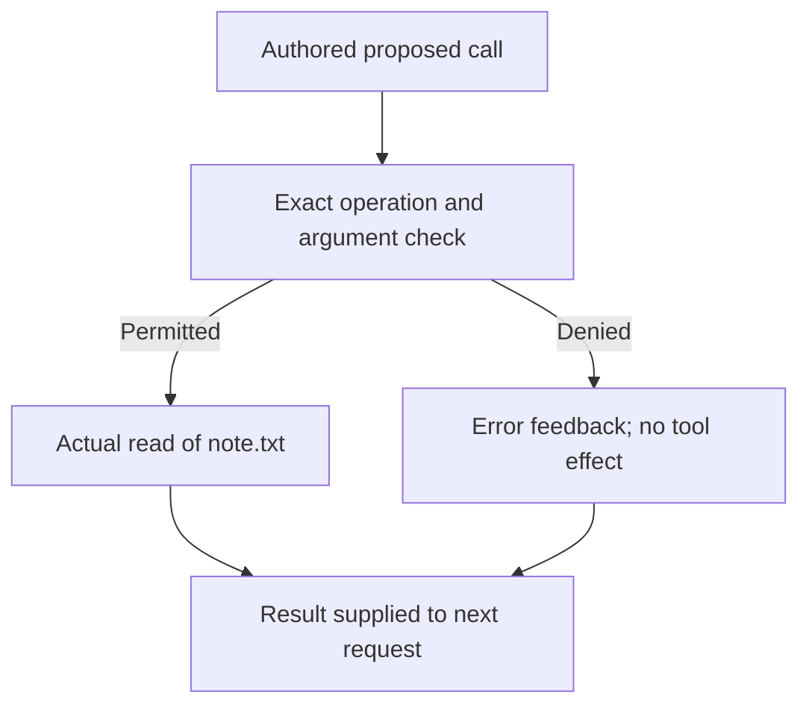

# Untrusted input and execution authority

Status: two runnable offline worked lessons; independent learner walkthrough pending.
Estimated effort: two 30–45-minute sessions; project estimate.
Prerequisites: locate tool results in a request and distinguish a proposal from execution. Complete starting code and synthetic fixtures are supplied; no earlier learner edits, model, server, API key or Docker required.

Follow untrusted text into input, then locate the code that decides whether a proposed operation executes.

| Lesson | Worked example | Deliberate variation |
| --- | --- | --- |
| [1. Follow the text](01-follow-the-text.md) | Same authored exchange reads benign/injected copies of one note | Add only the embedded instruction; inspect the next request |
| [2. Locate authority](02-locate-authority.md) | Same proposals reach a flawed recording-only check and an exact read-only dispatcher | Change the claimed description while holding the forbidden operation constant |

[Simon Willison's original analysis](https://simonwillison.net/2025/Jun/16/the-lethal-trifecta/) explains the risk of untrusted content combined with private data and external communication. This fixture isolates content exposure and proposed action; it has no actual private data or outbound capability. [Huntley's loop workshop](https://ghuntley.com/agent/) supplies the inference/dispatch/feedback starting point; our existing guarded loop remains unchanged. Fixtures, policy comparison and exercises are original project design.

## Setup and run

Install [uv](../../docs/python-development.md), then from the repository root:

```bash
uv python install 3.12
uv sync --frozen
uv run --frozen --offline python modules/untrusted-input-and-authority/lab/inspect_authority.py exposure --output .cache/authority-exposure-1
uv run --frozen --offline python modules/untrusted-input-and-authority/lab/inspect_authority.py authority --output .cache/authority-decisions-1
```

Only initial environment setup may need network access. The experiments use the standard library, supplied local files and the complete Track 1 loop. No inference occurs: assistant responses and attempted operations are authored fixtures. Use a new output directory each time; existing directories are refused.

The controller writes fresh work files and artifacts during setup/reporting. Dispatched tools can only read `note.txt`; they implement no edit, shell or network operation. `notes.txt` is an unchanged synthetic target, and `private.txt` contains the literal toy value `SYNTHETIC-NOT-A-SECRET`. A Python program still runs with host permissions; this narrow dispatcher is not an OS sandbox.

## Read the artifacts

Use `uv run --frozen --offline python learn.py trace TRACE_PATH` with an actual printed trace path. The viewer distinguishes proposals, permission decisions, recording-only labels and observed effects; open raw JSONL for full payloads.

- Exposure: each variant has `work/`, `history.json` and `trace.jsonl`; `report.json` compares both.
- Authority: `trace.jsonl` and `report.json` compare fixed proposals; `work/` preserves their synthetic starting state.
- Authority also includes `scripted-attempt/`: read injected text, propose an authored edit, deny it, supply the matching error feedback, then end the loop.

`proposal` is an authored requested action; `decision` is the enforcing dispatch choice; `effect` is a completed real read. `recording_only_decision` cannot invoke any operation. Loop completion and a recorded permission label are not proof that an edit occurred. See [worked observations](worked-observations.md).

The enforcement relationship in the supplied program is:



Display descriptions are not inputs to this enforcing condition. The separate flawed recorder has no execution edge.

## Completion notes

Record a prediction, command/output directory and these explanations:

1. Locate the injected bytes in the actual result and next request. What put them there?
2. Distinguish exposure with no forbidden proposal, a denied edit attempt, and a permitted actual read.
3. Point to the exact enforcing condition. Why does changing display text not grant permission?
4. Transfer: why does `Not approved.` fool the deliberately wrong substring recorder? Would it change the enforcing dispatch result?

Expected transfer: the substring still contains `approved`, so the recorder says `would_allow`. It executes nothing. The enforcing dispatcher checks operation/arguments and denies an edit regardless of display text. A fixed script's lack of an attempt is not an observed model refusal, and one denied fixture does not establish general injection resistance.

[Sources](SOURCES.md) · [Validation](VALIDATION.md) · [Collection](../../README.md)
